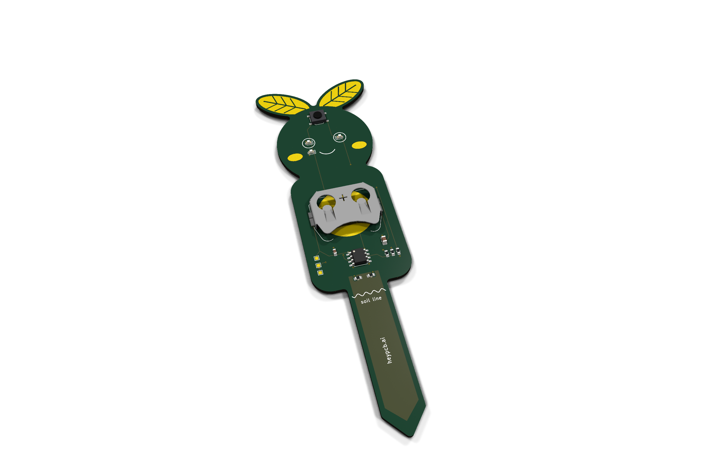
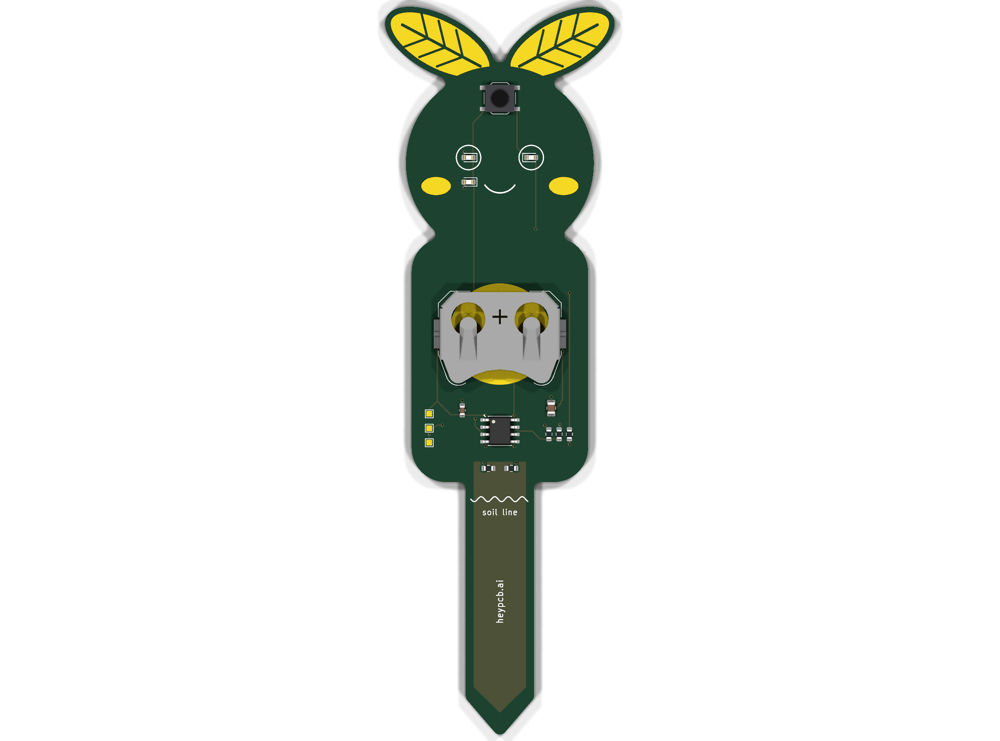
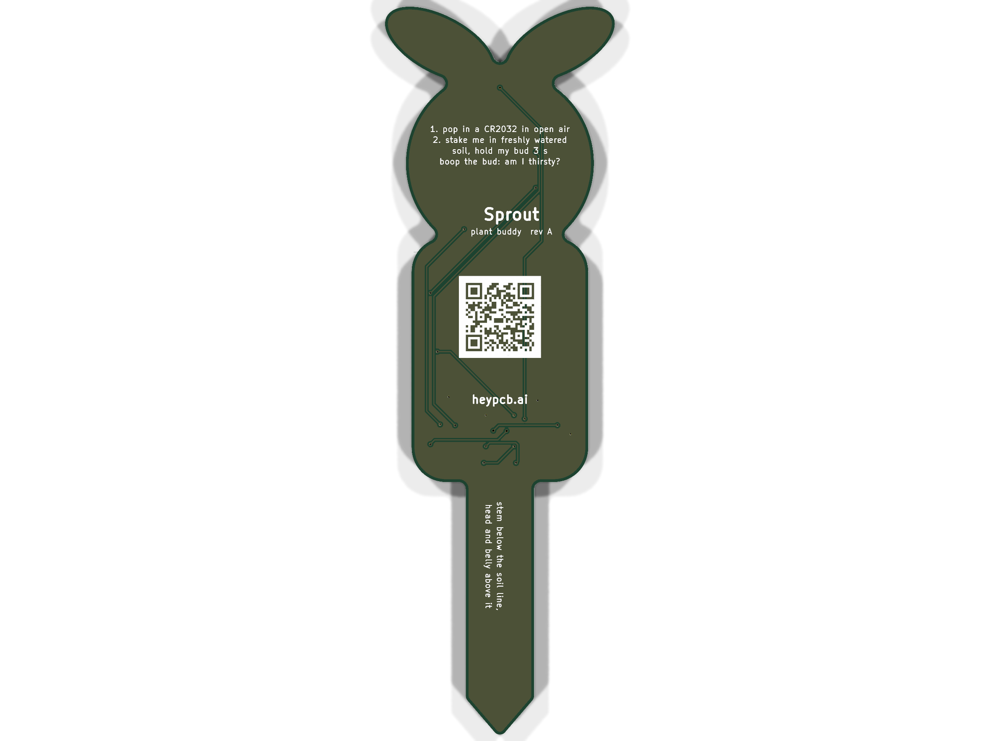

# Sprout, the plant buddy

**A circuit-board sprout that cries a little blue tear when your plant is thirsty.**

Sprout is a capacitive soil-moisture stake that lives in a plant pot on one CR2032. Its stem carries a mask-covered electrode; an ATtiny412 times how long that electrode takes to charge through 1 MΩ, and wet soil takes several times longer than dry. When the soil dries out, a blue LED tear drips under its left eye; when the plant is fine it winks. Boop the bud between its gold leaves for an instant answer.

| Layers | Size | Parts | Nets | Connections routed | Vias | ERC errors | DRC errors / unconnected / parity | BOM @100 |
|---|---|---|---|---|---|---|---|---|
| 2 | 40.4 x 128.0 mm | 13 (+3 pads) | 12 | 26 -> 0 open | 22 | 0 | 0 / 0 / 0 | $1.15 |

**Not fabricated, assembled or powered yet.** Every number on this page is measured by KiCad 10.0.6 on
the files in this repository ([`report.json`](report.json), [`measured.json`](measured.json)) or read
from the live JLC/LCSC catalogue ([`bom_cost.json`](bom_cost.json)).

| | |
|---|---|
| Spec, power budget, BOM | [`SPEC.md`](SPEC.md) |
| Store copy | [`STORE_COPY.md`](STORE_COPY.md) |
| KiCad 10 project | [`kicad/`](kicad/) |
| Gerbers, drill, BOM, CPL, STEP, schematic PDF | [`fab/`](fab/) |
| Firmware | [`firmware/`](firmware/) |
| Renders | [front](media/top.png), [back](media/bottom.png), [hero](media/hero.png), [Circuit World thumbnail](media/circuit-world.png) |
| Brief and generator | [`design/`](design/) |

 

## What's on it

- **Sensor:** a 9 mm-wide electrode down the stem (an F.Cu pour of its own net, under solder mask) over the back's ground plane; no metal touches the soil.
- **MCU:** ATtiny412 (SOIC-8, 1.8-5.5 V), asleep in power-down between 8 s RTC wakes; soil read about once a minute, calibration in EEPROM.
- **Face:** two green 0603 LED eyes, a blue 0603 LED tear, gold blush cheeks, a silk smile; gold leaves with mask-green veins.
- **Button:** the bud (TS-1187A): boop to check, hold 3 s in freshly watered soil to learn wet.
- **Power:** one CR2032 in a Keystone 3034 SMT holder, about two years with a watered plant (SPEC.md).
- **Programming:** three UPDI pads (VCC, UPDI, GND) for any USB-serial adapter.

## Finish

Green solder mask, White silkscreen, ENIG copper finish, 1.6 mm FR4, top-side SMT assembly.
The gold art is bare copper under a mask opening (ENIG), drawn with its own keep-out so no track runs
under it. The QR code on the back opens [https://heypcb.ai/world/b/cdb211161e60](https://heypcb.ai/world/b/cdb211161e60).

## How it was made

Designed with the HeyPCB method on KiCad 10.0.6, headless, by the `heypcb-kicad` pipeline: a written
brief composed from reusable circuit blocks, every pin from KiCad's own symbol library, every part bound
to an LCSC number from a dated catalogue read, then ERC, a netlist round trip, locked placement,
Freerouting 2.4.1, pours, silkscreen and board art, DRC with schematic parity, DFM and a fab gate,
each stage gated by a measurement. `design/make_brief.py` regenerates the brief (outline, part
locks and art) from code.

Part of the [heypcb.ai merch collection](https://github.com/HeyPCB/merch).

## License

Hardware: [CERN-OHL-S v2](LICENSE). Firmware: MIT (see [`firmware/LICENSE`](firmware/LICENSE)). KiCad's symbol, footprint and 3D
libraries used in the design are CC-BY-SA 4.0 with the KiCad library exception.
